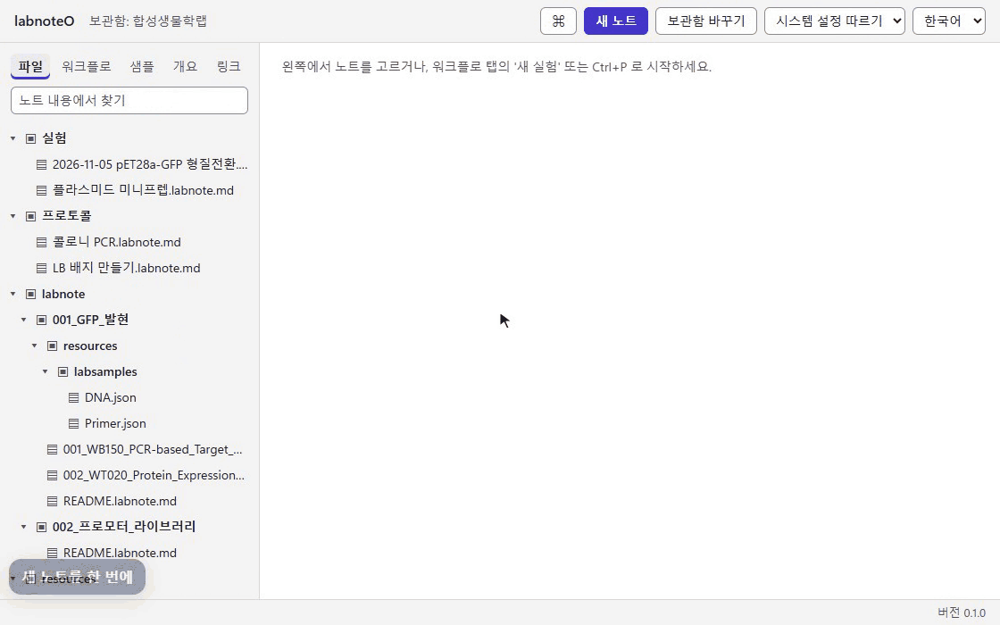

# labnoteO Desktop

**labnoteO 연구노트를 설치 파일 하나로. 플러그인도, 따로 할 준비도 필요 없습니다.**

labnoteO Desktop은 생물학·생물정보학 실험용 마크다운 연구노트 [labnoteO](https://github.com/sblabkribb/labnoteo)를
Windows 독립 앱으로 만든 것입니다. 설치 파일 하나로 설치하며, 다른 프로그램이나 플러그인이 필요 없습니다.
노트는 내 PC 폴더의 `.labnote.md` 평문 마크다운 파일이라, 같은 폴더를 labnoteO 플러그인이나 다른 마크다운
편집기에서도 그대로 쓸 수 있습니다.

[English](README.md) · **한국어**

[기능](#기능) · [설치](#설치) · [소스에서 빌드](#소스에서-빌드) · [로드맵](#로드맵) · [Apache-2.0 라이선스](LICENSE)

> **버전 0.1.0.** labnoteO 플러그인의 기능을 데스크톱 앱으로 모두 옮겼습니다. 샘플, 워크플로, PartBank,
> bfworkflow, LLM 보조, 노트 ID, 스캔 가져오기를 데스크톱 앱에서 바로 쓸 수 있습니다. 아직 남은 일은
> [로드맵](#로드맵)을 보세요.

## 기능

아래 GIF는 데모 보관함을 연결한 앱 화면을 그대로 녹화한 것입니다.

### 설치 하나로 시작

처음 실행하면 새 보관함을 만들거나 노트가 있는 폴더를 엽니다. 한 번 정하면 다음부터는 바로 열립니다.
기존 노트 폴더도 그대로 열 수 있고, 다른 앱이 그 안에 둔 설정 폴더는 건드리지 않습니다.


### 새 노트를 한 번에

이름을 적고 바로 씁니다. 노트 목록은 디스크의 변화를 따라가므로, 앱 밖에서 만들거나 이름을 바꾸거나 지운
파일도 반영됩니다.



### 라이브 미리보기로 편집

쓰는 대로 서식이 보이고, 노트의 프런트매터는 속성 표로 나타납니다. Ctrl+E를 누르면 마크다운
원본 보기와 미리보기를 오갑니다. 편집은 자동으로 저장되고, 편집 중에 디스크의 노트가 바뀌면 덮어쓰기 전에
물어봅니다.


### 표

표를 넣고 Tab으로 칸 사이를 이동합니다. 마지막 칸에서 Tab을 누르면 행이 늘어나므로, 마크다운의 `|` 기호를
직접 치지 않고도 결과를 채울 수 있습니다.


### 워크플로와 유닛 오퍼레이션

워크플로 패널은 실험을 상태별로 모아 보여 줍니다. 카탈로그에서 유닛 오퍼레이션을 넣고 체크리스트를
체크하면 진행률이 패널에 바로 반영됩니다.


### 링크, 백링크, 개요

`[[`를 입력하면 다른 노트로 가는 링크를 자동 완성합니다. 링크를 눌러 노트를 열고, 어떤 노트가 이 노트를
가리키는지 백링크로 확인하고, 개요 패널로 제목 사이를 이동합니다.


### 샘플

`@`를 입력해 샘플을 참조합니다. 샘플 패널에서 각 샘플의 설명과 보관 위치를 보고, 명령 하나로 이 실험의
시료 목록을 노트에 표로 넣습니다.


### 보관함 전체 검색

모든 노트의 본문을 로컬 SQLite 색인으로 검색합니다. 단어 중간도 찾으므로 "형질전환을", "카나마이신이"처럼
조사가 붙은 한국어도 잘 찾습니다.


### LLM 보조

로컬 모델을 포함해 OpenAI 호환 엔드포인트라면 어디든 연결해, 워크플로 결과 요약 같은 AI 명령을 노트에
실행합니다. 결과는 콜아웃으로 들어가므로 그대로 두거나 고칠 수 있습니다. API 키는 보관함이 아니라 Windows
자격 증명 관리자에만 보관합니다.


### PartBank

PartBank에서 부품을 찾아 바로 샘플로 등록하면 보관 위치도 함께 가져옵니다.
[bfworkflow](https://github.com/sblabkribb/bfworkflow)도 같은 방식으로 연결해 카탈로그를 동기화하고 설계에서
노트를 만듭니다.


### 노트 ID, QR 코드, 실험 기록지

노트마다 ID와 QR 코드, 바코드가 붙습니다. 유닛 오퍼레이션별 A4 실험 기록지나 노트 전체를 출력해 실험대에서
손으로 기록합니다.


### 스캔 가져오기

손으로 채운 기록지를 찍거나 스캔해 가져오면, QR 코드로 맞는 노트를 찾아 해당 유닛 오퍼레이션 아래에
이미지로 정리합니다. 지정한 스캔 폴더나 Slack 채널에서도 가져올 수 있습니다.


### MCP 서버

내장 MCP 서버를 켜면 AI 클라이언트가 노트를 읽고 다룰 수 있습니다. 서버는 127.0.0.1에서만 듣고, 앱이 접근
토큰이 들어간 클라이언트 설정을 바로 복사해 줍니다.


### 다른 AI 도구에서 쓰기

떠 있는 도우미는 앱 안의 AI(설정 → 연동에서 고른 제공자)로 움직입니다. Claude Code나 DeepSeek
Harness(`dsh`) 같은 다른 AI 도구는 앱에 넣지 않으며, 그 도구를 위한 Node.js 같은 실행 환경도 함께
배포하지 않습니다. 대신 바깥에서 같은 보관함에 연결합니다.

1. 설정 → 연동에서 MCP 서버를 켜고 클라이언트 설정을 복사해 그 도구에 넣습니다.
2. "Claude Code 에 설치"로 labnoteO 스킬(SKILL.md)을 설치하거나, "다른 이름으로 저장…"으로 저장해 그
   도구가 읽게 합니다. 스킬은 보관함 구조와 MCP 도구를 알려 줍니다.
3. 그 도구에 실험 작업을 맡깁니다. 바꾸는 일은 모두 MCP 서버의 승인을 거치고, 그 도구의 키는 labnoteO가
   아니라 그 도구에 남습니다.

도우미가 이 도구들을 대신 부르지는 않습니다. 도구들은 MCP 서버와 바로 이야기합니다.

### GitHub에 올리기

짧은 코드로 GitHub에 한 번 로그인하면, 실험 폴더 하나가 내 계정이나 연구실 조직 아래의 비공개 저장소 하나가
됩니다. 보내기 전에 올라갈 파일 목록을 먼저 확인하고, 앱의 접근 권한은 github.com에서 언제든 거둘 수
있습니다.

### 밝게 · 어둡게 · 한국어 · English

밝은 테마와 어두운 테마 중에 고르거나 Windows 설정을 따릅니다. 화면 언어는 언제든 한국어와 영어 사이에서
바꿀 수 있고, 바로 적용되며 저장하지 않은 편집도 그대로 남습니다.


## 설치

Windows 10 또는 11 (64비트).

설치 파일은 [Releases](https://github.com/sblabkribb/labnoteo-desktop/releases) 페이지에 올라갑니다.
**아직 공개된 릴리스는 없습니다.** 그때까지는 [소스에서 빌드](#소스에서-빌드)하세요.

- 설치 파일에 코드 서명이 없어 처음 설치할 때 Windows SmartScreen 경고가 뜹니다.
  **추가 정보 → 실행**을 누르세요.
- 릴리스가 공개되면, 설치된 앱은 새 릴리스로 스스로 업데이트합니다.

## 소스에서 빌드

준비물: [Node.js](https://nodejs.org/) 22, [Rust](https://rustup.rs/) stable 툴체인,
Microsoft C++ Build Tools, WebView2(Windows 11에는 이미 들어 있음).
[Tauri 준비물](https://tauri.app/start/prerequisites/) 문서를 참고하세요.

```powershell
git clone --recursive https://github.com/sblabkribb/labnoteo-desktop.git
cd labnoteo-desktop/app
npm ci
npm test
npm run tauri:build
```

설치 파일은 `app/src-tauri/target/x86_64-pc-windows-msvc/release/bundle/nsis/` 에 만들어집니다.
개발할 때는 `npm run tauri dev` 를 실행합니다.

labnoteO 코어(`@labnoteo/core`)는 `app/vendor/labnoteo` 에 git 서브모듈로 들어 있어, 앱과 labnoteO 플러그인이
같은 노트 로직을 함께 씁니다. 예약된 워크플로(`sync-core`)가 6시간마다 labnoteO의 새 릴리스를 확인합니다.
새 릴리스에서 앱의 테스트와 빌드가 통과하면 자동으로 `main`에 반영하고, 실패하면 어느 릴리스가 앱을
깨뜨렸는지 이슈로 알립니다.

## 로드맵

labnoteO Desktop은 labnoteO의 기능을 모두 옮겨, 이 앱 하나로 모든 것을 할 수 있게 하는 것을 목표로 합니다.

| 영역 | 상태 |
|---|---|
| 보관함, 노트 목록, 마크다운 편집기, 자동 저장, 전체 검색, 테마, 한국어/영어 | 사용 가능 |
| 편집기: 라이브 미리보기, 속성 표, 표 편집, 위키링크 자동 완성·이동, 백링크, 개요 | 사용 가능 |
| 샘플: `@` 자동 완성, 샘플 보기, 실험 시료 표 | 사용 가능 |
| 워크플로·유닛 오퍼레이션, 워크플로 패널, 체크리스트 | 사용 가능 |
| PartBank 연동: 부품 검색, 보관 위치, 사용처 보고 | 사용 가능 |
| 노트 ID, QR 코드·바코드, 실험 기록지 출력, 스캔 가져오기(스캔 폴더, Slack) | 사용 가능 |
| [bfworkflow](https://github.com/sblabkribb/bfworkflow) 연동: 카탈로그 동기화, 설계에서 노트 만들기 | 사용 가능 |
| LLM 보조(로컬 모델을 포함한 OpenAI 호환 엔드포인트)와 MCP 서버 | 사용 가능 |
| 실험 표 CSV 내보내기 | 예정 |
| 실험 폴더를 GitHub에 올리기(기본 비공개) | 사용 가능 |

API 키(PartBank, bfworkflow, LLM, Slack, GitHub)는 보관함이 아니라 Windows 자격 증명 관리자에 보관합니다.

## 라이선스

[Apache License 2.0](LICENSE).
