# labnoteO Desktop

**생물학 실험 연구노트를 위한 Windows 앱**

labnoteO Desktop은 생물학·생물정보학 실험용 마크다운 연구노트 [labnoteO](https://github.com/sblabkribb/labnoteo)를
Windows 앱으로 만든 것입니다. 노트는 내 PC 폴더에 `.labnote.md` 평문 마크다운 파일로 저장되므로 다른 마크다운
편집기에서도 그대로 열립니다.

[English](README.md) · **한국어**

[기능](#기능) · [설치](#설치) · [소스에서 빌드](#소스에서-빌드) · [변경 기록](CHANGELOG.md) · [Apache-2.0 라이선스](LICENSE)

## 기능

처음 쓰는 사람이 만나는 순서대로 적었습니다. 아래 GIF는 지어낸 데이터로 만든 데모 보관함을 연결해, 실제
서버 없이 앱 화면을 그대로 녹화한 것입니다.

**시작하기**
[설치](#1-설치-하나로-시작) ·
[편집기](#2-편집기와-표) ·
[링크](#3-링크-백링크-개요) ·
[검색](#4-보관함-전체-검색)<br>
**실험 진행**
[새 실험](#5-새-실험과-첫-workflow) ·
[Workflow](#6-workflow와-unit-operation) ·
[순서 바꾸기](#7-workflow-순서-바꾸기끼워-넣기삭제-unit-operation-옮기기) ·
[상태](#8-실험-상태와-workflow-완료-체크) ·
[샘플](#9-샘플) ·
[첨부](#10-첨부-그림csv-보기-csv-내보내기) ·
[PartBank](#11-partbank) ·
[bfworkflow](#12-bfworkflow) ·
[기록지](#13-노트-id-qr-코드-실험-기록지) ·
[스캔](#14-스캔-가져오기)<br>
**AI**
[프로바이더](#15-ai-프로바이더와-결과-요약) ·
[도우미](#16-도우미) ·
[초안](#17-ai-초안-계획-초안과-method-초안) ·
[조회](#18-조회-웹-문헌-partbank-workflow-서버)<br>
**공유와 연결**
[GitHub](#19-github에-올리기) ·
[MCP](#20-mcp-서버와-외부-mcp-서버) ·
[다른 AI 도구](#21-다른-ai-도구에서-쓰기)<br>
**내 마음대로**
[스킨](#22-도우미-스킨과-갤러리) ·
[테마와 언어](#23-밝게--어둡게--한국어--english) ·
[업데이트](#24-자동-업데이트)

### 시작하기

#### 1. 설치 하나로 시작

처음 실행하면 새 보관함을 만들거나 노트가 있는 폴더를 엽니다. 한 번 정하면 다음부터는 바로 열립니다.
기존 폴더도 그대로 열 수 있고, 다른 앱이 그 안에 둔 설정 폴더는 건드리지 않습니다. 노트는 그 폴더에
`.labnote.md` 파일로 저장됩니다.

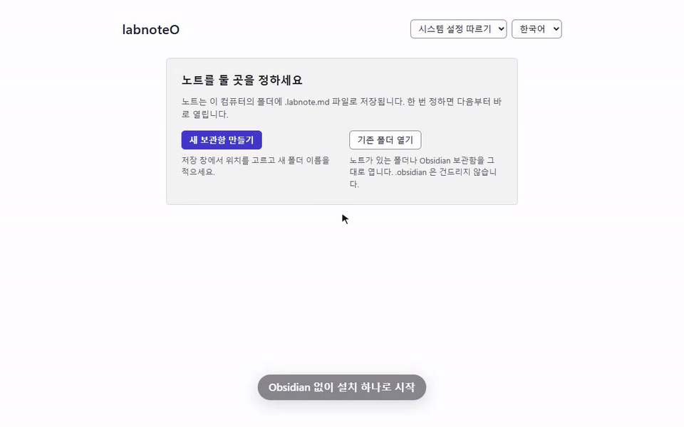

#### 2. 편집기와 표

쓰는 대로 서식이 보이고, 노트의 프런트매터는 상태 칩이 달린 속성 표로 나타납니다. 편집은 자동으로
저장되고, 편집 중에 디스크의 노트가 바뀌면 덮어쓰기 전에 물어봅니다. 오른쪽 클릭하면 **넣기**와 **서식**
메뉴가 나옵니다. Ctrl+E는 마크다운 원본 보기와 미리보기를 오가고, Ctrl+O는 빠른 이동을 엽니다. 명령
팔레트는 모든 명령을 쓰임새별로 묶고 단축키도 함께 보여 줍니다.

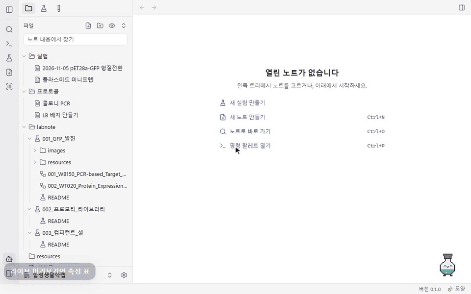

표를 넣고 Tab으로 칸 사이를 이동합니다. 마지막 칸에서 Tab을 누르면 행이 늘어나므로, 마크다운의 `|` 기호를
직접 치지 않고도 결과를 채울 수 있습니다.

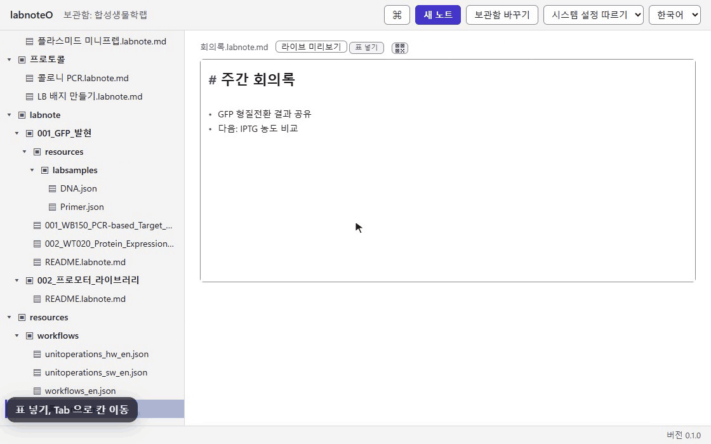

#### 3. 링크, 백링크, 개요

`[[`를 입력하면 다른 노트로 가는 링크를 자동 완성합니다. 링크를 눌러 노트를 열고, 어떤 노트가 이 노트를
가리키는지 백링크로 확인하고, 개요로 제목 사이를 이동합니다. 개요와 링크는 리본에서 여는 오른쪽 사이드바에
있습니다.

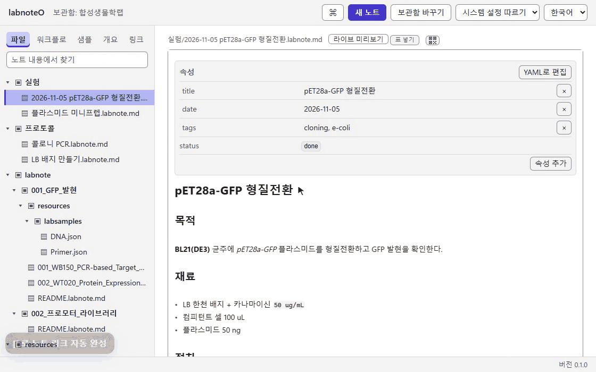

#### 4. 보관함 전체 검색

모든 노트의 본문을 로컬 SQLite 색인으로 검색합니다. 낱말 중간도 찾으므로 "형질전환을", "카나마이신이"처럼
조사가 붙은 한국어도 잘 찾습니다.

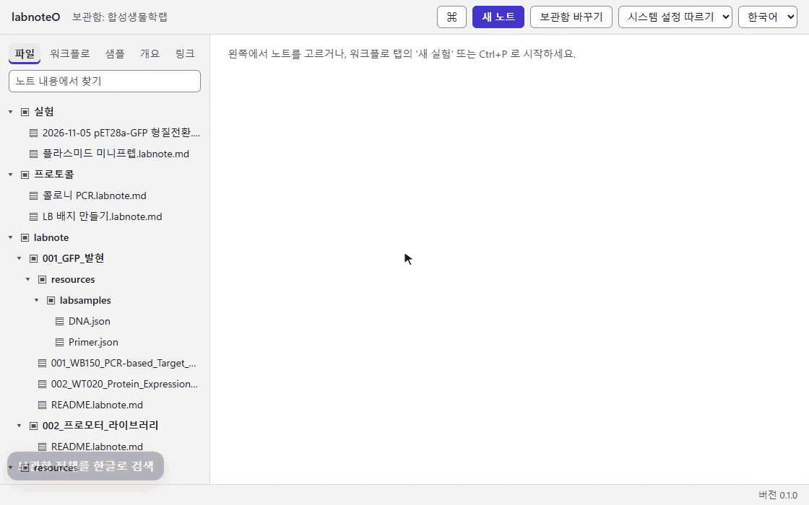

### 실험 진행

#### 5. 새 실험과 첫 Workflow

실험은 폴더 하나이고, 그 안의 Workflow는 번호가 붙은 노트이며, Workflow마다 Unit Operation이 들어갑니다.
**새 실험**은 제목과 실험자만 묻습니다(실험자는 미리 채워져 있습니다). 그러면 실험의 README가 카탈로그에서
첫 Workflow를 고르도록 안내합니다. 카탈로그는 앱에 들어 있고, 명령 팔레트의 **카탈로그 업데이트하기**로
새로 받으며, **bfworkflow 카탈로그 동기화하기**로 연구실의 카탈로그를 가져옵니다.

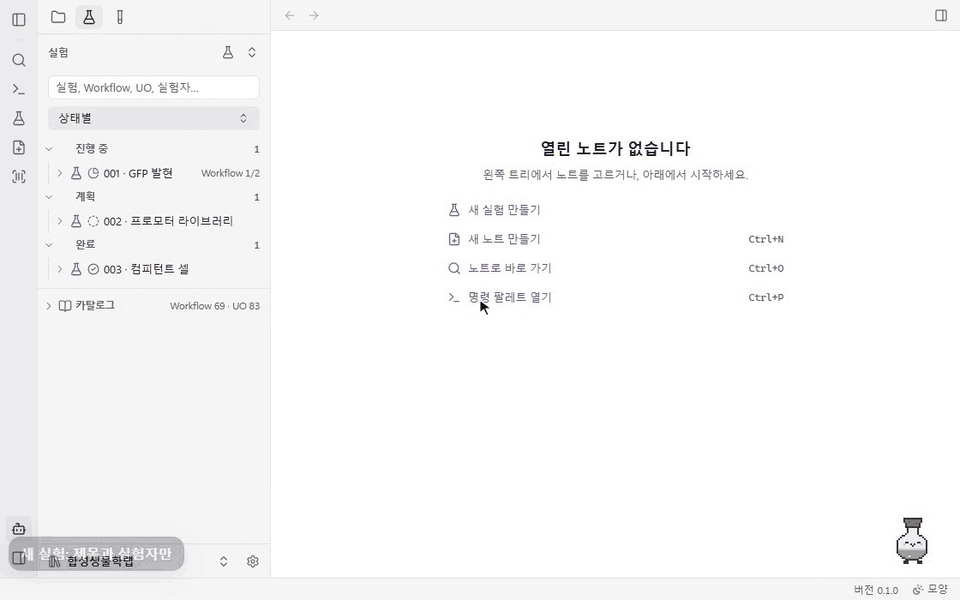

#### 6. Workflow와 Unit Operation

실험 패널은 실험과 그 안의 Workflow, Unit Operation을 보여 주며, 상태·실험자·프로젝트·최근 수정·논의 중으로
묶어 볼 수 있습니다. **UO 추가**는 카탈로그의 Unit Operation을 시작일·종료일 칩이 달린 카드로 넣습니다.
체크리스트 진행률과 Workflow 개수가 작업하는 대로 패널에 반영되고, 노트의 `last_updated`도 알아서
적힙니다.

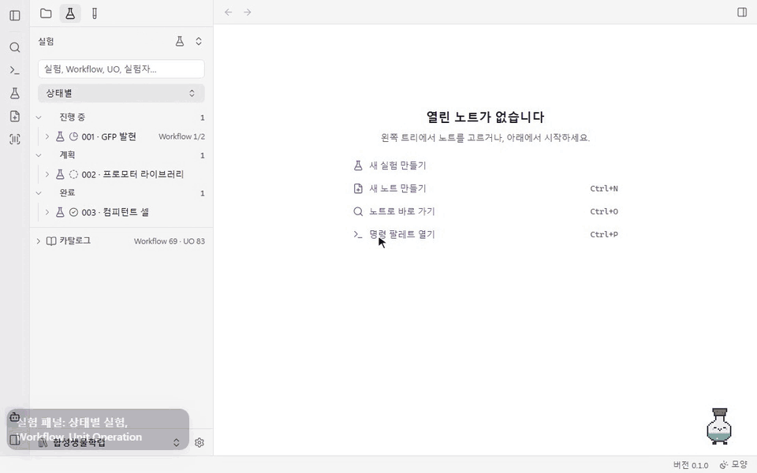

#### 7. Workflow 순서 바꾸기·끼워 넣기·삭제, Unit Operation 옮기기

Workflow는 메뉴, Alt+Shift+↑/↓, 끌어 놓기로 옮깁니다. **여기 뒤에 Workflow 추가**로 사이에 끼워 넣고,
**Workflow 삭제…**로 휴지통에 보냅니다. 파일 번호와 링크, README 체크리스트가 바뀐 대로 맞춰집니다.
Unit Operation도 노트 안에서 같은 방법으로 옮깁니다.

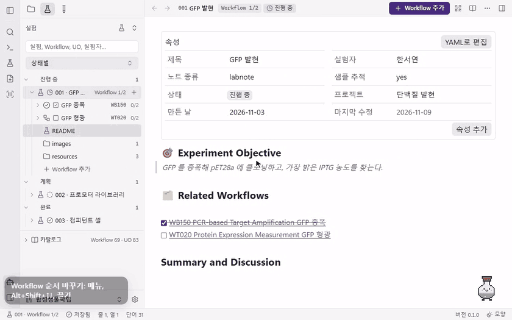

#### 8. 실험 상태와 Workflow 완료 체크

실험의 상태 아이콘을 누르면 상태(계획, 진행 중, 검토 필요, 완료, 실패, 중단, 반복 필요 등)를 고르거나 지울
수 있고, 실험은 그 상태의 묶음으로 옮겨 갑니다. Workflow마다 완료 체크가 트리와 노트 머리에 있고, 실험에는
"Workflow n/m"이 표시됩니다. Workflow를 모두 마치면 실험을 완료로 표시할지 넌지시 묻습니다.

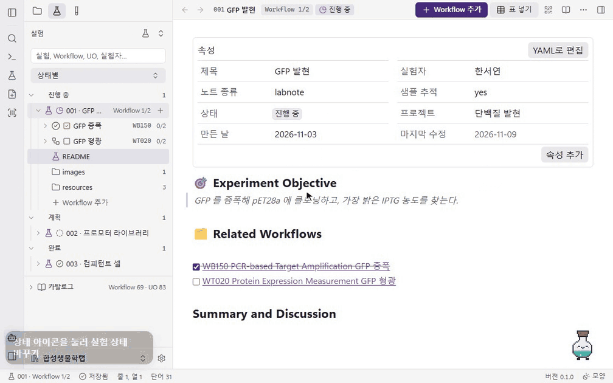

#### 9. 샘플

`@`를 입력해 샘플을 참조합니다. 샘플 패널에서 각 샘플의 설명과 보관 위치를 보고, 명령 하나로 이 실험의
시료 목록을 노트에 표로 넣습니다.

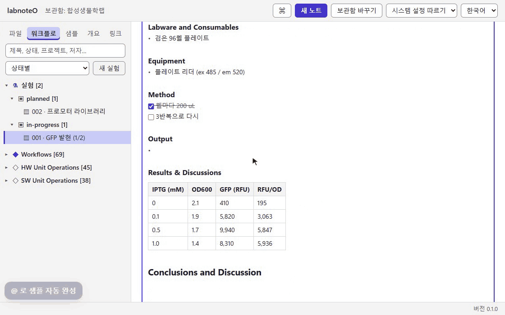

#### 10. 첨부, 그림·CSV 보기, CSV 내보내기

노트에 끌어 놓은 파일은 실험의 `resources` 폴더에 저장됩니다. 그림과 CSV는 앱 안에서 바로 열리고(그림은
확대·맞춤, CSV는 표), 다른 파일은 **기본 앱으로 열기**와 **폴더에서 보기**가 있는 카드로 보입니다.
**이 노트의 표를 CSV로 내보내기**(또는 실험의 표 모두)는 노트 옆에 CSV 파일을 만듭니다.

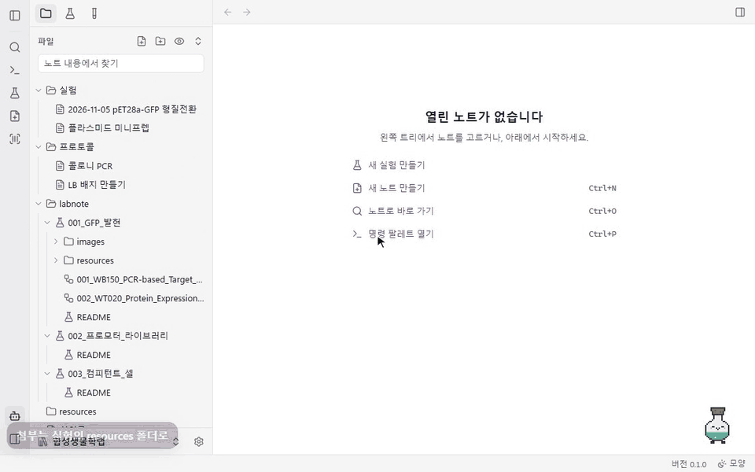

#### 11. PartBank

PartBank에서 부품을 찾아 바로 샘플로 등록하면 보관 위치도 함께 가져오고, 사용처도 보고할 수 있습니다.

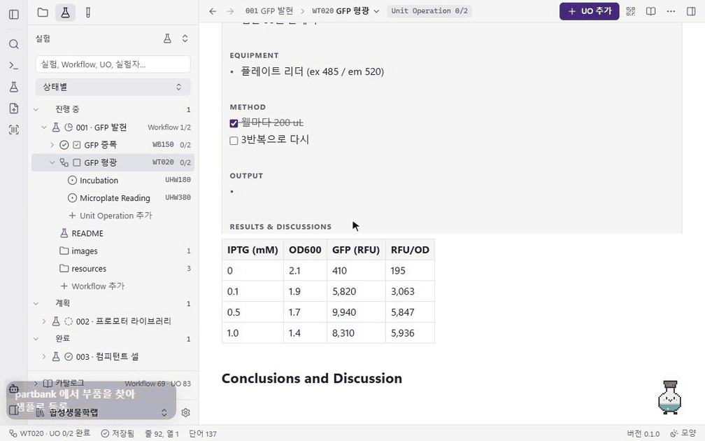

#### 12. bfworkflow

Workflow 서버인 [bfworkflow](https://github.com/sblabkribb/bfworkflow)를 연결하면 연구실의 카탈로그를
동기화하고(명령 팔레트의 **bfworkflow 카탈로그 동기화하기**), 서버의 설계에서 바로 노트를 만듭니다
(**bfworkflow 설계에서 노트 만들기**).

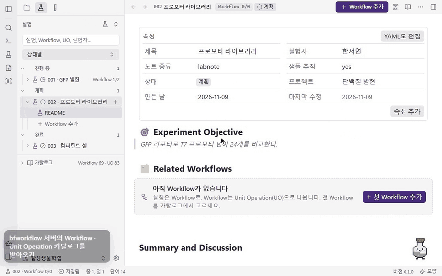

#### 13. 노트 ID, QR 코드, 실험 기록지

노트마다 ID와 QR 코드, 바코드가 붙습니다. Unit Operation별 A4 실험 기록지나 노트 전체를 출력해 실험대에서
손으로 기록합니다.

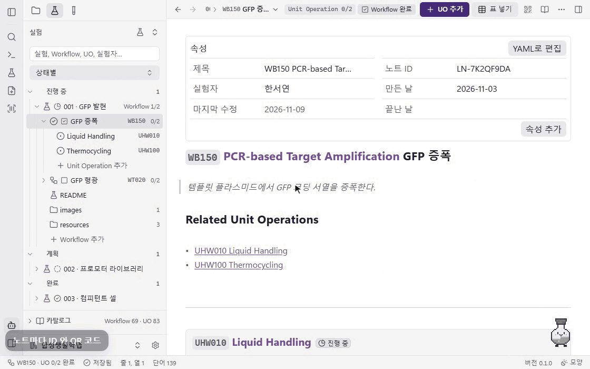

#### 14. 스캔 가져오기

손으로 채운 기록지를 찍거나 스캔해 가져오면, QR 코드로 맞는 노트를 찾아 해당 Unit Operation 아래에
이미지로 정리합니다. 지정한 스캔 폴더나 Slack 채널에서도 가져올 수 있습니다.

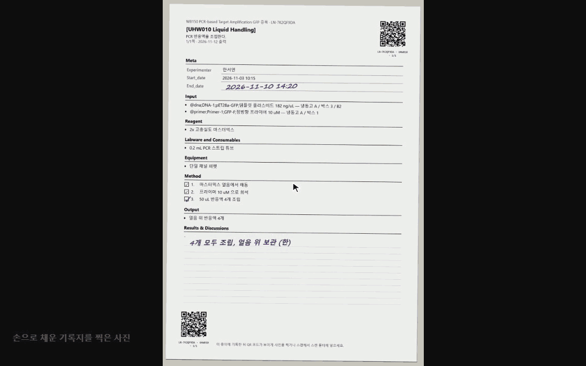

### AI

#### 15. AI 프로바이더와 결과 요약

로컬 모델을 포함해 OpenAI 호환 엔드포인트라면 어디든 연결합니다. **연결 확인**은 모델을 확인하고 컨텍스트
크기를 읽어 옵니다. 생각 모드, 최대 출력 토큰, 온도는 **고급**에 있습니다. API 키는 보관함이 아니라 Windows
자격 증명 관리자에만 보관합니다. **AI: Workflow 결과 요약하기** 같은 AI 명령은 답을 모델과 날짜가 적힌
콜아웃으로 노트에 넣습니다.

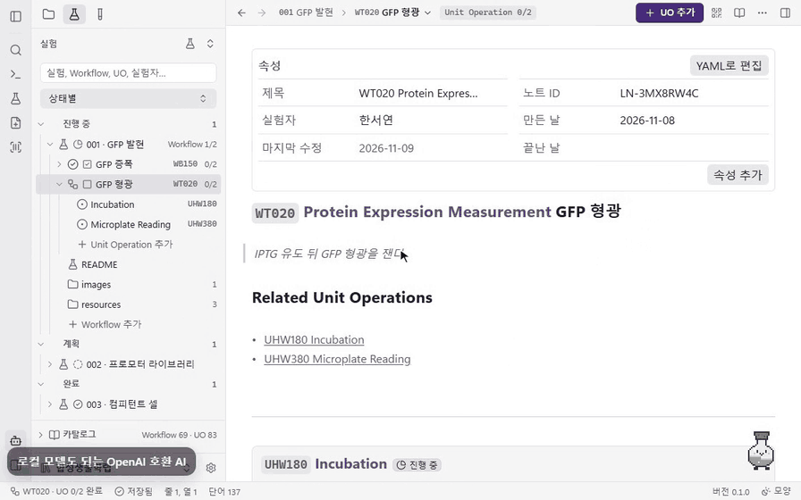

#### 16. 도우미

오른쪽 아래의 플라스크 Flasko가 앱 안의 도우미입니다. 누르면 사용법, 섹션 만들기, Unit Operation 만들기,
Workflow 만들기 칩과 자유 대화가 나옵니다. Workflow와 Unit Operation 질문은 카탈로그 설명부터 찾아 답하고,
답마다 눌러 볼 수 있는 출처 칩이 붙습니다. **노트에 넣기**는 답을 출처 목록과 함께 넣습니다. 노트를 바꾸는
일은 미리 보기를 보여 주고 허용할 때만 합니다. 대화 창은 크기를 바꿀 수 있고, 대화 기록은 보관함이 아니라
이 PC의 앱 폴더에 실험별로 남습니다.

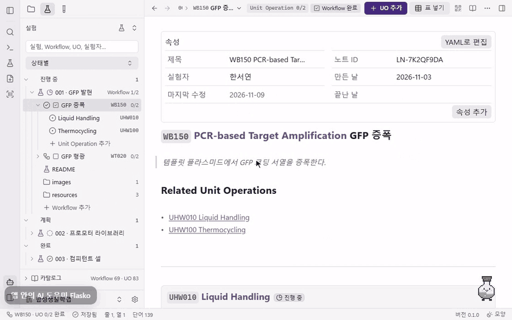

#### 17. AI 초안: 계획 초안과 Method 초안

**AI: Unit Operation 계획 초안 쓰기**는 먼저 AI에 보낼 문맥(README, 앞 단계, 카탈로그 설명, 프로토콜)과
토큰 어림값을 보여 주므로, 보내고 싶지 않은 것은 체크를 풀 수 있습니다. 그다음 생각하고 쓰는 과정을
실시간으로 보여 주며 Reagent, Labware, Equipment, Method 섹션을 채웁니다. **AI: Method 섹션 초안 쓰기**와
**AI: 이전 단계 출력으로 Input 채우기**도 같은 방식입니다. AI가 쓴 줄은 **검토 완료**를 누를 때까지
표시되고(Esc는 한 번에 지움), 이 표시는 파일에 남지 않습니다. 원하면 설정에서 예전의 "검토 후 이 줄을
지우세요" 표시 줄을 파일에 남기게 할 수 있습니다.

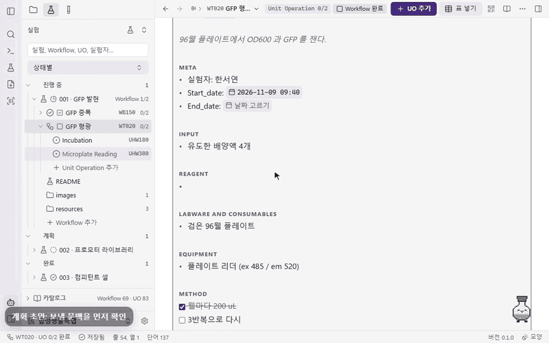

#### 18. 조회: 웹, 문헌, PartBank, Workflow 서버

도우미가 직접 찾아보고 답마다 출처를 보여 줍니다. PartBank의 부품과 보관 위치(내 것·그룹·공개 표시),
PubMed, Europe PMC, Crossref, bioRxiv의 논문, 내 SearXNG 검색 서버를 통한 웹 페이지, Workflow 서버의 설계와
방법을 찾습니다. 이 도구들은 모두 읽기만 하며, 웹 검색은 하기 전에 묻습니다.

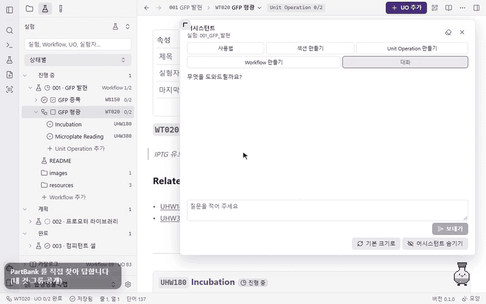

### 공유와 연결

#### 19. GitHub에 올리기

짧은 코드로 GitHub에 한 번 로그인하면, 실험 폴더 하나가 내 계정이나 연구실 조직 아래의 비공개 저장소 하나가
됩니다. 보내기 전에 올라갈 파일 목록을 확인하며, `.env`나 키 파일 같은 비밀 파일은 항상 빠지고 저장된 키가
들어 있지 않은지도 검사합니다. 다음부터는 바뀐 것만 올립니다. 앱의 접근 권한은 github.com에서 언제든 거둘
수 있습니다.

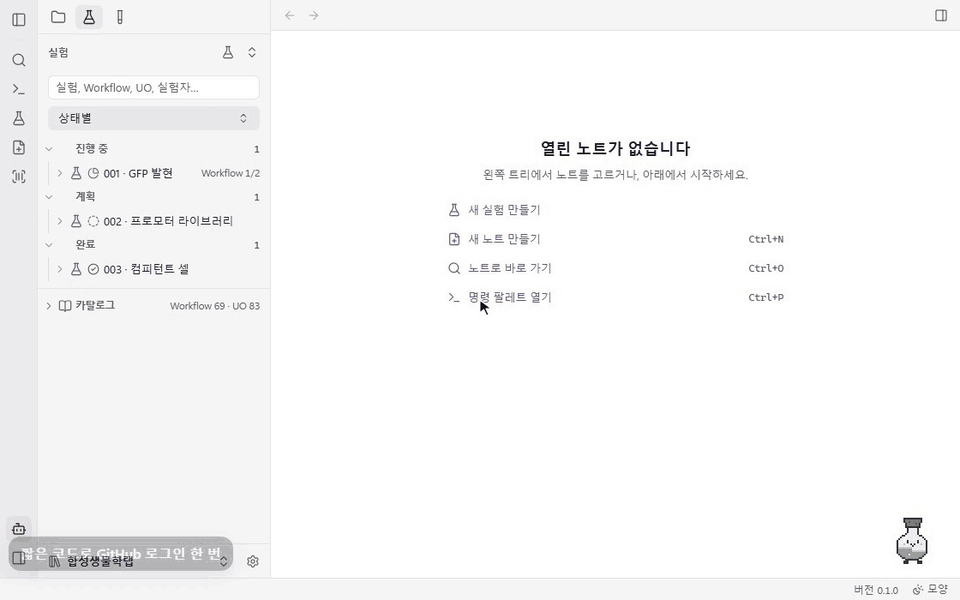

#### 20. MCP 서버와 외부 MCP 서버

내장 MCP 서버를 켜면 AI 클라이언트가 노트를 읽고 다룰 수 있습니다. 서버는 127.0.0.1에서만 듣고, 앱이 접근
토큰이 들어간 클라이언트 설정을 바로 복사해 줍니다. 반대로 외부 MCP 서버(RAPID, BioModel Portal 미리 설정
또는 직접 추가)를 등록하고, 서버마다 도우미가 그 도구를 쓸지 정할 수 있습니다.

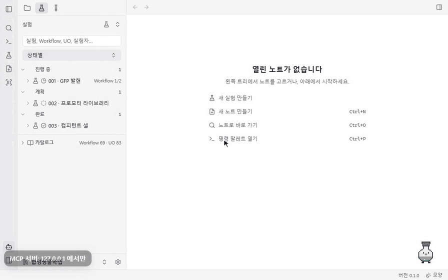

#### 21. 다른 AI 도구에서 쓰기

Flasko는 앱 안의 AI(설정 → 연동에서 고른 프로바이더)로 움직입니다. Claude Code나 DeepSeek
Harness(`dsh`) 같은 다른 AI 도구는 앱에 넣지 않으며, 그 도구를 위한 Node.js 같은 실행 환경도 함께
배포하지 않습니다. 대신 바깥에서 같은 보관함에 연결합니다.

1. 설정 → 연동에서 MCP 서버를 켜고 클라이언트 설정을 복사해 그 도구에 넣습니다.
2. "Claude Code 에 설치"로 labnoteO 스킬(SKILL.md)을 설치하거나, "다른 이름으로 저장…"으로 저장해 그
   도구가 읽게 합니다. 스킬은 보관함 구조와 MCP 도구를 알려 줍니다.
3. 그 도구에 실험 작업을 맡깁니다. 바꾸는 일은 모두 MCP 서버의 승인을 거치고, 그 도구의 키는 labnoteO가
   아니라 그 도구에 남습니다.

도우미가 이 도구들을 대신 부르지는 않습니다. 도구들은 MCP 서버와 바로 이야기합니다.

### 내 마음대로

#### 22. 도우미 스킨과 갤러리

도우미의 모습은 스킨으로 바꿉니다. 스킨 갤러리에서 스킨마다 움직임을 미리 보고, 만든 사람과 라이선스를
확인한 뒤 설치합니다. `.labnoteo-skin` 파일로 가져오고 내보낼 수 있고, **내 스킨 만들기**로 PNG 스프라이트
시트에서 직접 스킨을 만들며 바로 미리 볼 수 있습니다.

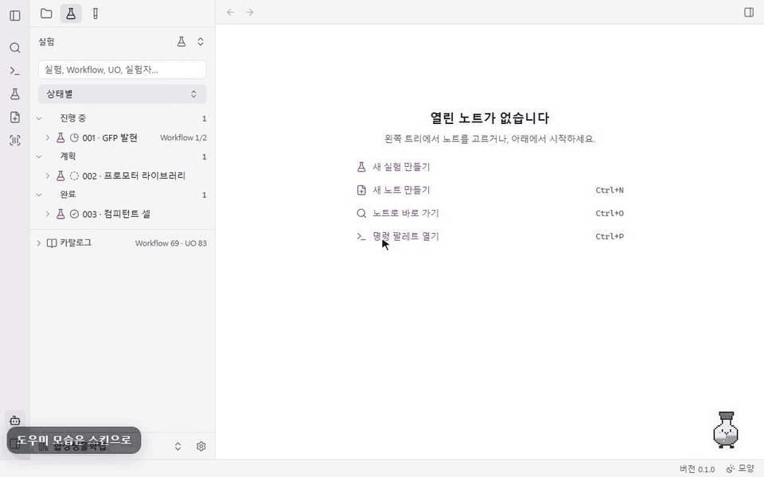

#### 23. 밝게 · 어둡게 · 한국어 · English

상태 표시줄의 모양 버튼에서 밝은 테마와 어두운 테마 중에 고르거나 Windows 설정을 따릅니다. 화면 언어는
언제든 한국어와 영어 사이에서 바꿀 수 있고, 바로 적용되며 저장하지 않은 편집도 그대로 남습니다.

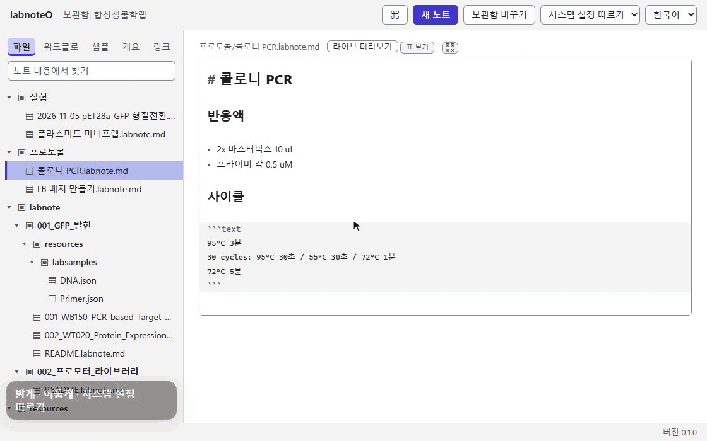

#### 24. 자동 업데이트

설치된 앱은 켤 때, 6시간마다, 그리고 한 시간 넘게 자리를 비웠다 돌아올 때 새 버전을 확인합니다. 새 버전은
뒤에서 조용히 받으며, 왼쪽 아래 버튼에 진행률이 보입니다. 설치는 **업데이트** 버튼을 누를 때만 하고, 열린
노트는 먼저 저장합니다. 명령 팔레트의 **업데이트 확인하기**로 바로 확인할 수도 있습니다.

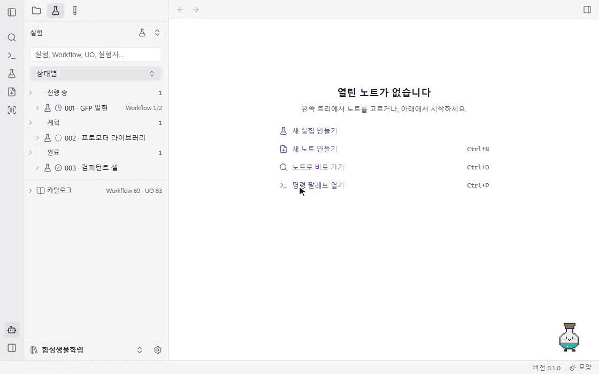

## 설치

Windows 10 또는 11 (64비트).

설치 파일은 [Releases](https://github.com/sblabkribb/labnoteo-desktop/releases) 페이지에 올라갑니다.
직접 빌드하려면 [소스에서 빌드](#소스에서-빌드)를 보세요.

- 설치 파일에 코드 서명이 없어 처음 설치할 때 Windows SmartScreen 경고가 뜹니다.
  **추가 정보 → 실행**을 누르세요.
- 설치한 뒤에는 앱이 새 릴리스로 [스스로 업데이트](#24-자동-업데이트)합니다.

### 직접 설정할 것

앱은 계정 없이도 동작합니다. 아래 연결은 필요할 때만 **설정 → 연동**에서 입력합니다(연결 파일이 있으면
**파일로 한 번에 가져오기**로 한꺼번에 불러올 수 있습니다).

- **AI 프로바이더**: OpenAI 호환 엔드포인트의 주소, 모델, API 키(로컬 모델은 키가 없어도 됨). AI 명령, 초안,
  도우미에 필요합니다.
- **PartBank**와 **bfworkflow**(Workflow 서버): 주소와 API 키.
- **웹 검색**: 도우미가 웹을 검색하게 하려면 SearXNG 서버 주소.
- **Slack에서 스캔 가져오기**: Slack 봇 토큰과 채널.
- **GitHub**: 처음 올릴 때 로그인하면 됩니다. 토큰을 복사할 필요가 없습니다.

API 키와 토큰은 보관함이 아니라 Windows 자격 증명 관리자에 보관합니다.

## 소스에서 빌드

준비물: [Node.js](https://nodejs.org/) 22, [Rust](https://rustup.rs/) stable 툴체인,
Microsoft C++ Build Tools, WebView2(Windows 11에는 이미 들어 있음).
[Tauri 준비물](https://tauri.app/start/prerequisites/) 문서를 참고하세요.

```powershell
git clone --recursive https://github.com/sblabkribb/labnoteo-desktop.git
cd labnoteo-desktop/app
npm ci
npm test
npm run tauri:build
```

설치 파일은 `app/src-tauri/target/x86_64-pc-windows-msvc/release/bundle/nsis/` 에 만들어집니다.
개발할 때는 `npm run tauri dev` 를 실행합니다.

labnoteO 코어(`@labnoteo/core`)는 `app/vendor/labnoteo` 에 git 서브모듈로 들어 있어, 앱과 labnoteO 플러그인이
같은 노트 로직을 함께 씁니다. 예약된 GitHub Actions 작업(`sync-core`)이 6시간마다 labnoteO의 새 릴리스를
확인합니다. 새 릴리스에서 앱의 테스트와 빌드가 통과하면 자동으로 `main`에 반영하고, 실패하면 어느 릴리스가
앱을 깨뜨렸는지 이슈로 알립니다.

## 라이선스

[Apache License 2.0](LICENSE).
