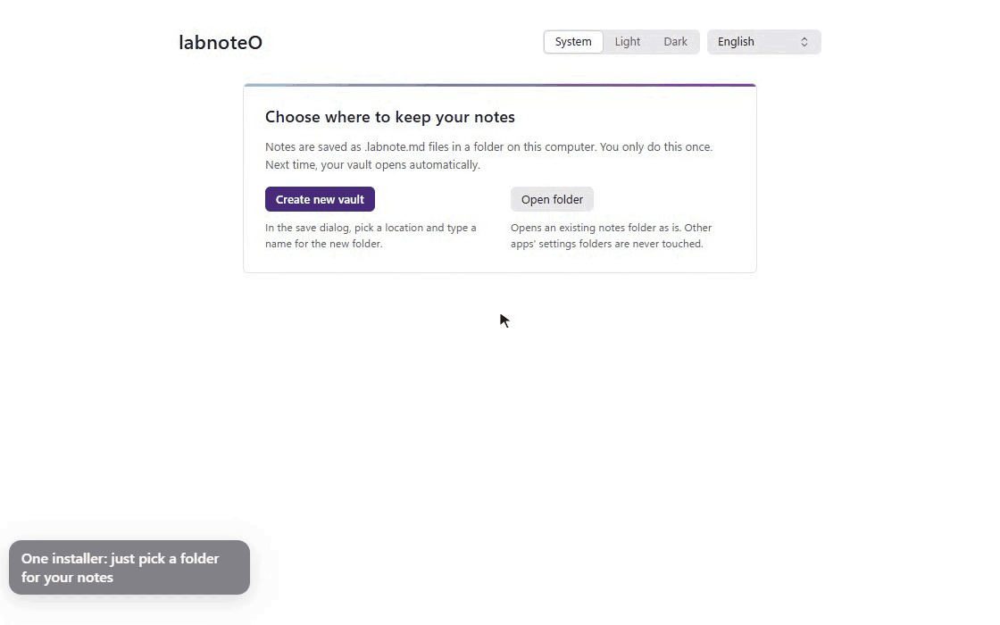
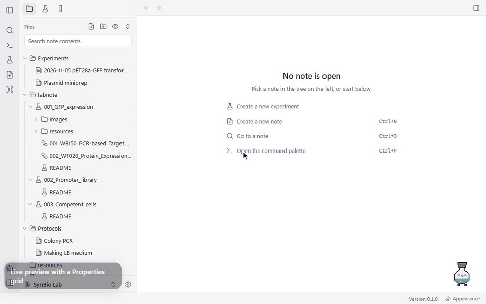
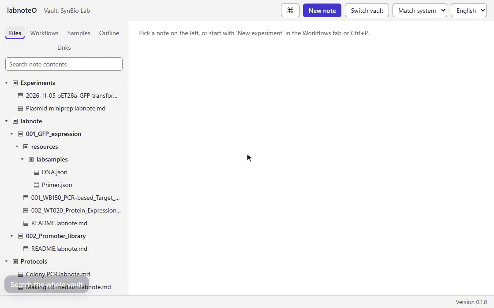
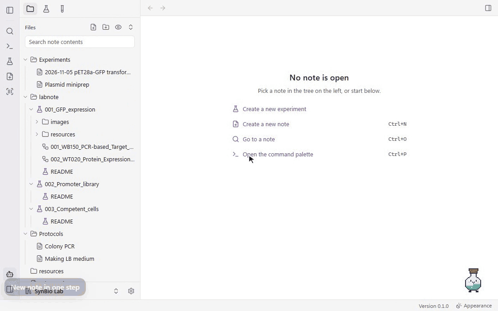
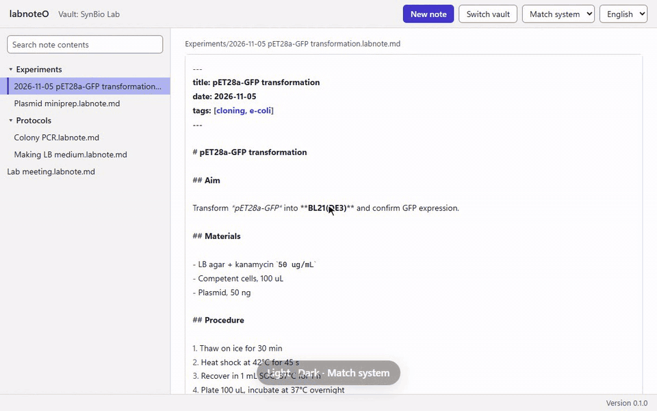

# labnoteO Desktop

**The labnoteO lab notebook as one Windows app. No Obsidian, no plugins, no setup.**

labnoteO Desktop is a standalone Windows app for [labnoteO](https://github.com/sblabkribb/labnoteo),
the Markdown lab notebook for biology and bioinformatics experiments. Today, using labnoteO means
installing Obsidian, adding the BRAT community plugin and then installing labnoteO through it.
This app replaces all of that with a single installer. Your notes stay plain `.labnote.md` files in a
folder on your PC, so the same folder still opens in Obsidian.

**English** · [한국어](README.ko.md)

[Features](#features) · [Install](#install) · [Build from source](#build-from-source) · [Roadmap](#roadmap) · [Apache-2.0 License](LICENSE)

> **Early preview (0.1.0).** The notebook basics shown below work today. The rest of labnoteO's
> features (samples, workflows, PartBank, bfworkflow, the LLM assistant) are being ported; see the
> [roadmap](#roadmap).

## Features

The GIFs below were recorded from the app's own interface, running against a demo vault.

### Start with one installer

Create a new vault or open an existing notes folder on first launch. The app remembers it and opens
straight into it next time. An existing Obsidian vault opens as is; its `.obsidian` folder is never
touched.



### Edit Markdown lab notes

Write in Markdown with syntax highlighting for headings, emphasis, lists, tables, code blocks and
`[[wikilinks]]`. Edits save automatically. If a note changes on disk while you are editing (for
example after a sync), the app asks before overwriting it. It never silently discards either version.



### Search the whole vault

Full-text search across every note, backed by a local SQLite index. It also matches inside words,
which matters for Korean, where a term is usually followed by a particle.



### Create a note in one step

Name it and start writing. The note list follows changes on disk, including files created, renamed
or deleted outside the app.



### Light, dark, English, Korean

Choose a light or dark theme, or match Windows. Switch between English and Korean at any time;
the switch is instant and keeps unsaved edits.



## Install

Windows 10 or 11 (64-bit).

Installers are published on the [Releases](https://github.com/sblabkribb/labnoteo-desktop/releases)
page. **No release has been published yet**; until then, [build from source](#build-from-source).

- The installer is not code-signed, so Windows SmartScreen shows a warning on first install.
  Choose **More info → Run anyway**.
- Once releases are published, an installed app updates itself from them.

## Build from source

Prerequisites: [Node.js](https://nodejs.org/) 22, the [Rust](https://rustup.rs/) stable toolchain,
the Microsoft C++ Build Tools, and WebView2 (already part of Windows 11). See the
[Tauri prerequisites](https://tauri.app/start/prerequisites/).

```powershell
git clone --recursive https://github.com/sblabkribb/labnoteo-desktop.git
cd labnoteo-desktop/app
npm ci
npm test
npm run tauri:build
```

The installer is written to
`app/src-tauri/target/x86_64-pc-windows-msvc/release/bundle/nsis/`.
For development, run `npm run tauri dev`.

The labnoteO core (`@labnoteo/core`) is included as a git submodule at `app/vendor/labnoteo`, so
the app and the Obsidian plugin share the same note logic.

## Roadmap

labnoteO Desktop aims to carry over every labnoteO feature, so nobody needs Obsidian to use it.

| Area | Status |
|---|---|
| Vault, note list, Markdown editor, autosave, full-text search, themes, English/Korean | Available |
| Editor: live preview, wikilink autocomplete and navigation, backlinks, outline | Next |
| Samples: `@` autocomplete, sample view, experiment sample tables | Planned |
| Workflows and unit operations, checklists, CSV export | Planned |
| PartBank integration: part search, storage locations, usage reports | Planned |
| Note IDs, QR worksheets, scan import | Planned |
| [bfworkflow](https://github.com/sblabkribb/bfworkflow) integration: catalog sync, notes from designs | Planned |
| LLM assistant (any OpenAI-compatible endpoint, including local models) and MCP server | Planned |
| Git automation for research repositories | Planned |

API keys (PartBank, bfworkflow, LLM) will be stored in the Windows credential store, never in the
vault.

## Documentation

- [Manual smoke test](docs/SMOKE-TEST.md): check a build by hand before release
- [Releasing](docs/RELEASING.md): signing keys, tags and the update feed

## License

[Apache License 2.0](LICENSE).
