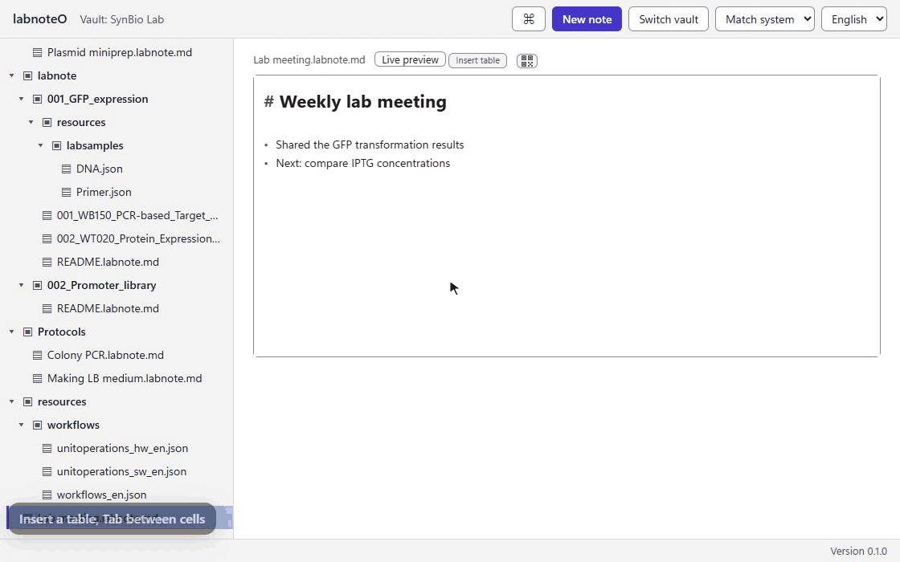
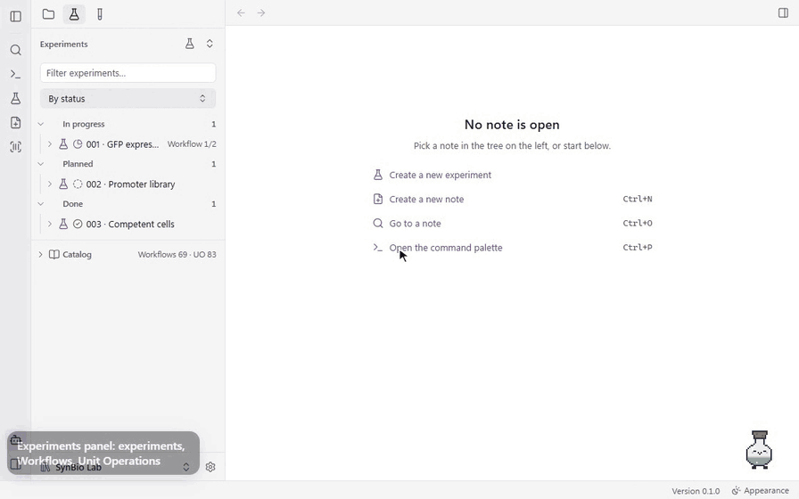
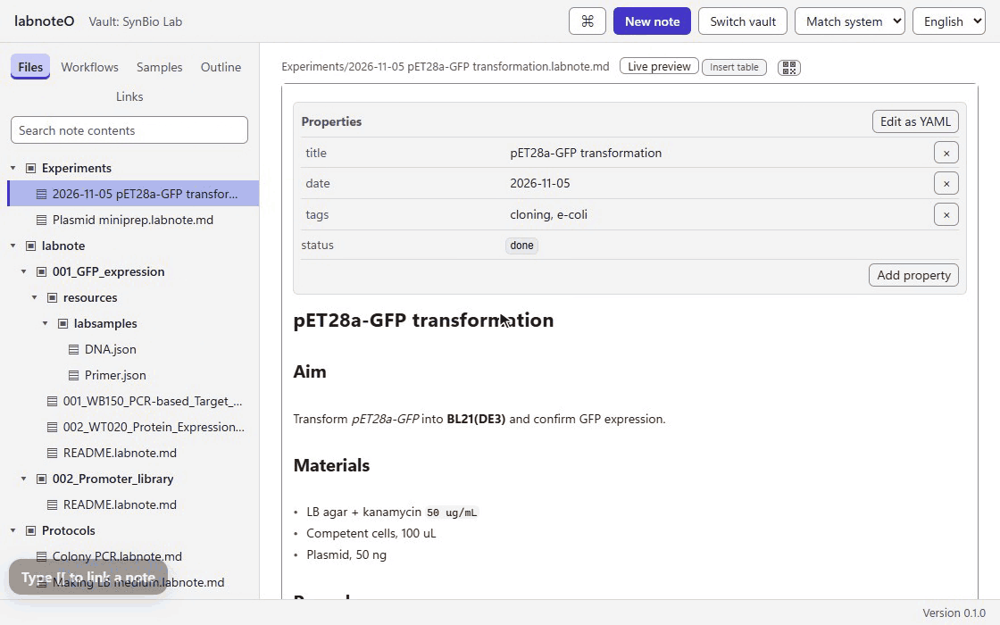
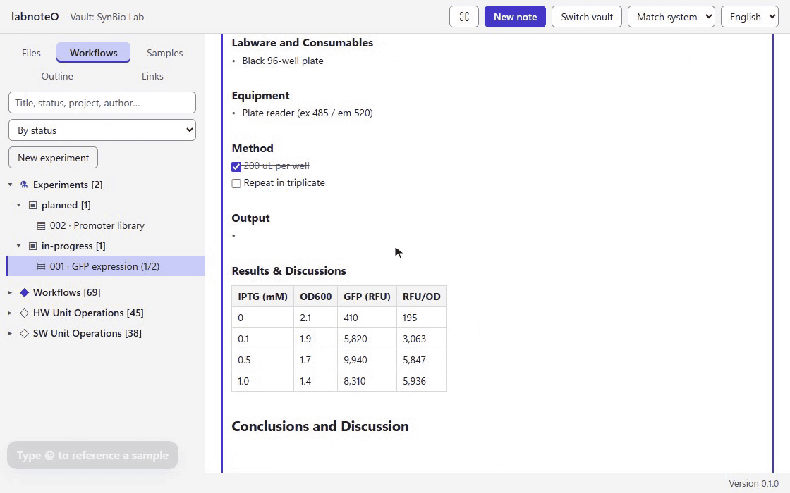
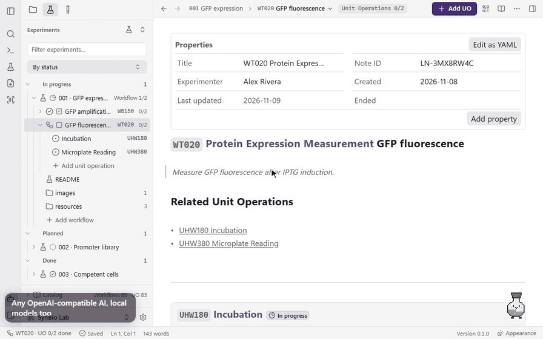
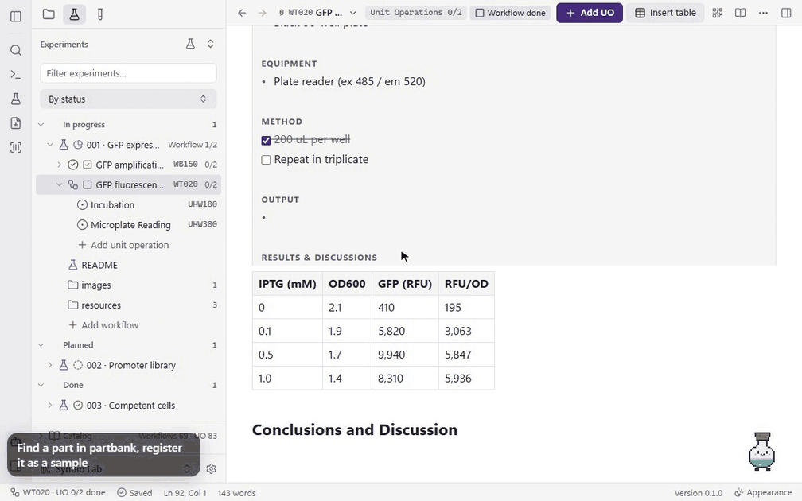
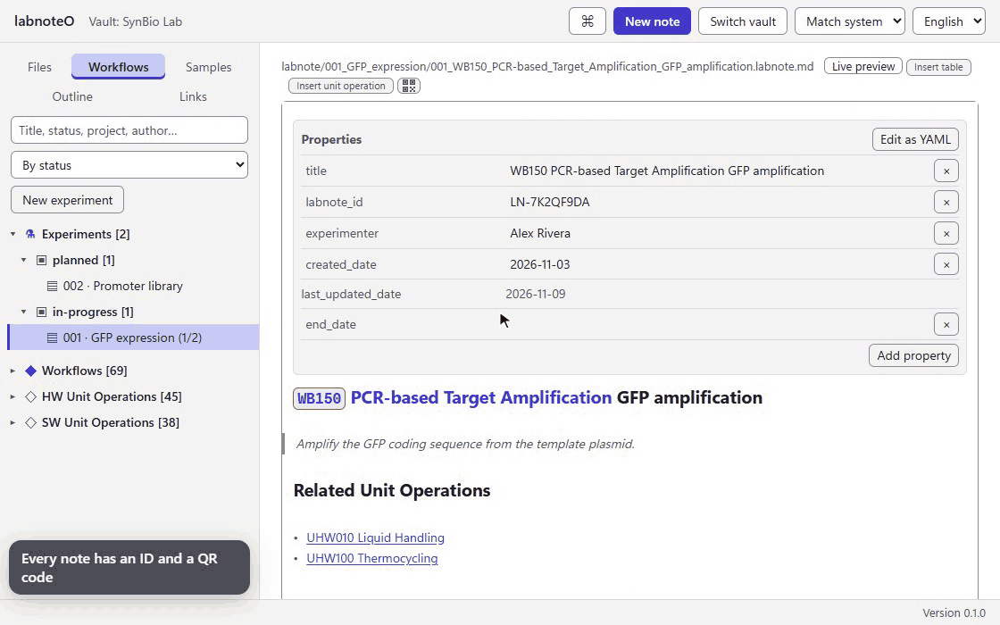
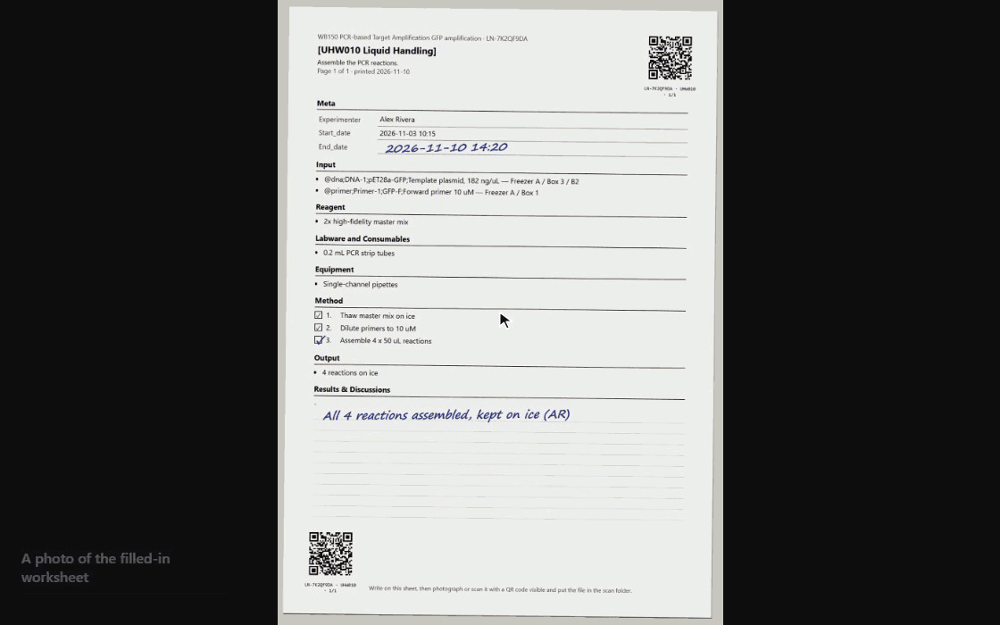
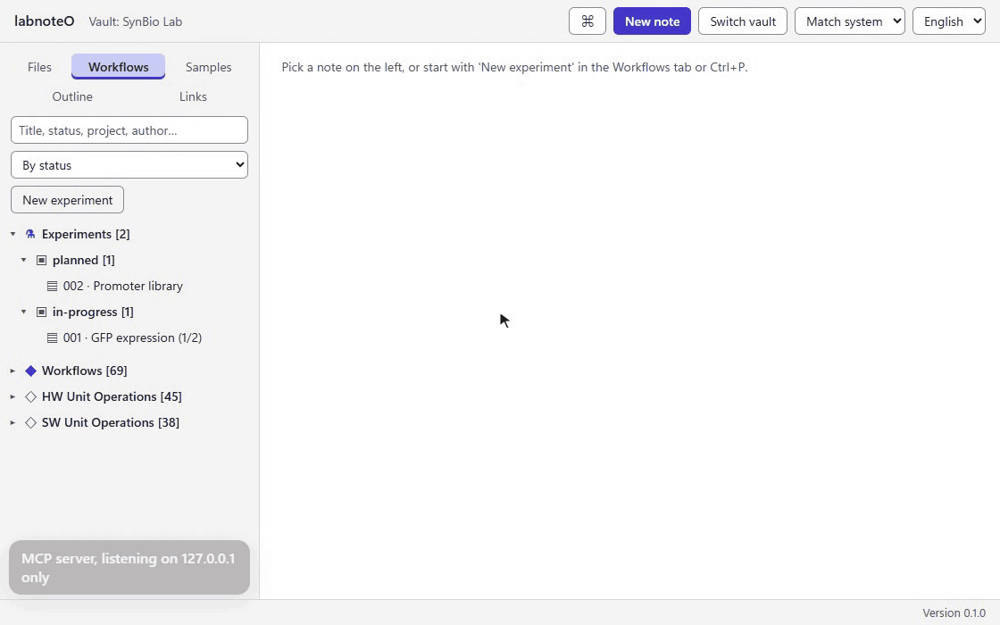

# labnoteO Desktop

**The labnoteO lab notebook as one Windows app. No Obsidian, no plugins, no setup.**

labnoteO Desktop is a standalone Windows app for [labnoteO](https://github.com/sblabkribb/labnoteo),
the Markdown lab notebook for biology and bioinformatics experiments. Today, using labnoteO means
installing Obsidian, adding the BRAT community plugin and then installing labnoteO through it.
This app replaces all of that with a single installer. Your notes stay plain `.labnote.md` files in a
folder on your PC, so the same folder still opens in Obsidian.

**English** · [한국어](README.ko.md)

[Features](#features) · [Install](#install) · [Build from source](#build-from-source) · [Roadmap](#roadmap) · [Apache-2.0 License](LICENSE)

> **Version 0.1.0.** labnoteO's plugin features are now ported to the desktop app: samples,
> workflows, PartBank, bfworkflow, the LLM assistant, note IDs and scan import all work without
> Obsidian. See the [roadmap](#roadmap) for what is still planned.

## Features

The GIFs below were recorded from the app's own interface, running against a demo vault.

### Start with one installer

Create a new vault or open an existing notes folder on first launch. The app remembers it and opens
straight into it next time. An existing Obsidian vault opens as is; its `.obsidian` folder is never
touched.


### Create a note in one step

Name it and start writing. The note list follows changes on disk, including files created, renamed
or deleted outside the app.


### Edit with live preview

Formatting shows as you type, the way it does in Obsidian, and a note's front matter appears as a
Properties grid. Press Ctrl+E to switch to the plain Markdown source and back. Edits save
automatically, and if a note changes on disk while you are editing, the app asks before overwriting it.


### Tables

Insert a table and move between cells with Tab. Pressing Tab in the last cell adds a new row, so
you can fill in results without typing the Markdown pipes yourself.



### Workflows and unit operations

The Workflows panel groups experiments by status. Insert a unit operation from the catalog, and
checklist progress shows up in the panel as you tick items off.



### Links, backlinks and outline

Type `[[` to link another note with autocomplete. Click a link to open it, see which notes link
back, and jump between headings with the outline.



### Samples

Type `@` to reference a sample. The Samples panel shows each sample's description and storage
location, and one command writes the experiment's sample table into the note.



### Search the whole vault

Full-text search across every note, backed by a local SQLite index. It also matches inside words,
which matters for Korean, where a term is usually followed by a particle.


### LLM assistant

Connect any OpenAI-compatible endpoint, including a local model, and run AI commands on a note,
such as summarizing workflow results. The answer is inserted as a callout you can keep or edit.
API keys are kept in Windows Credential Manager, never in the vault.



### PartBank

Search PartBank for a part and register it as a sample in one step; its storage location comes
along. [bfworkflow](https://github.com/sblabkribb/bfworkflow) connects the same way, to sync its
catalog and create notes from designs.



### Note IDs, QR codes and worksheets

Every note gets an ID with a QR code and barcode. Print an A4 worksheet per unit operation, or the
whole note, and fill it in by hand at the bench.



### Scan import

Photograph or scan a filled-in worksheet and import it: the QR code finds the right note, and the
image is filed under the matching unit operation. Scans can also come in from a watched folder or a
Slack channel.



### MCP server

Turn on the built-in MCP server to let an AI client read and work with your notes. It listens on
127.0.0.1 only, and the app copies a ready-made client setup with your access token.



### Using another AI tool

The floating assistant runs on the app's own AI (the provider you set in Settings → Integrations).
Other AI tools, such as Claude Code or DeepSeek Harness (`dsh`), are not built into the app and
the app ships no Node.js or other runtime for them. They connect from outside, on the same vault:

1. In Settings → Integrations, turn on the MCP server and copy the client setup into your tool.
2. Install the labnoteO skill (SKILL.md) with "Install for Claude Code", or save it with "Save as…"
   and point your tool at it. It explains the vault layout and the MCP tools.
3. Ask your tool to work on an experiment. Every change it makes goes through the MCP server's own
   approvals, and its keys stay in that tool, not in labnoteO.

The assistant does not relay these tools; they talk to the MCP server directly.

### Upload to GitHub

Sign in to GitHub once with a short code, and each experiment folder becomes its own private
repository under your account or your lab's organization. You check the list of files before
anything is sent, and you can revoke the app's access on github.com at any time.

### Light, dark, English, Korean

Choose a light or dark theme, or match Windows. Switch between English and Korean at any time;
the switch is instant and keeps unsaved edits.


## Install

Windows 10 or 11 (64-bit).

Installers are published on the [Releases](https://github.com/sblabkribb/labnoteo-desktop/releases)
page. **No release has been published yet**; until then, [build from source](#build-from-source).

- The installer is not code-signed, so Windows SmartScreen shows a warning on first install.
  Choose **More info → Run anyway**.
- Once releases are published, an installed app updates itself from them.

## Build from source

Prerequisites: [Node.js](https://nodejs.org/) 22, the [Rust](https://rustup.rs/) stable toolchain,
the Microsoft C++ Build Tools, and WebView2 (already part of Windows 11). See the
[Tauri prerequisites](https://tauri.app/start/prerequisites/).

```powershell
git clone --recursive https://github.com/sblabkribb/labnoteo-desktop.git
cd labnoteo-desktop/app
npm ci
npm test
npm run tauri:build
```

The installer is written to
`app/src-tauri/target/x86_64-pc-windows-msvc/release/bundle/nsis/`.
For development, run `npm run tauri dev`.

The labnoteO core (`@labnoteo/core`) is included as a git submodule at `app/vendor/labnoteo`, so
the app and the Obsidian plugin share the same note logic. A scheduled workflow
(`sync-core`) checks for a new labnoteO release every 6 hours. When the app's tests and build pass on
it, the update goes into `main` automatically; when they fail, an issue reports which release broke
the app.

## Roadmap

labnoteO Desktop aims to carry over every labnoteO feature, so nobody needs Obsidian to use it.

| Area | Status |
|---|---|
| Vault, note list, Markdown editor, autosave, full-text search, themes, English/Korean | Available |
| Editor: live preview, Properties grid, tables, wikilink autocomplete and navigation, backlinks, outline | Available |
| Samples: `@` autocomplete, sample view, experiment sample tables | Available |
| Workflows and unit operations, Workflows panel, checklists | Available |
| PartBank integration: part search, storage locations, usage reports | Available |
| Note IDs, QR codes and barcodes, worksheet printing, scan import (scan folder, Slack) | Available |
| [bfworkflow](https://github.com/sblabkribb/bfworkflow) integration: catalog sync, notes from designs | Available |
| LLM assistant (any OpenAI-compatible endpoint, including local models) and MCP server | Available |
| CSV export of experiment tables | Planned |
| Upload an experiment folder to GitHub (private by default) | Available |

API keys (PartBank, bfworkflow, LLM, Slack, GitHub) are stored in Windows Credential Manager, never in the
vault.

## License

[Apache License 2.0](LICENSE).
