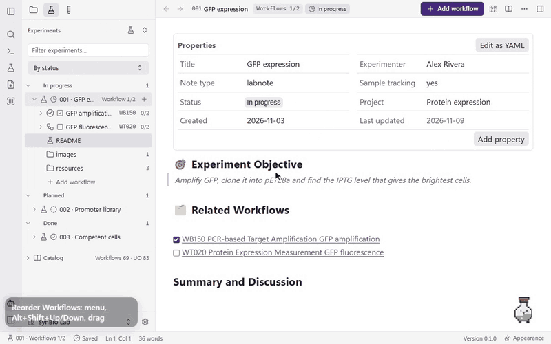
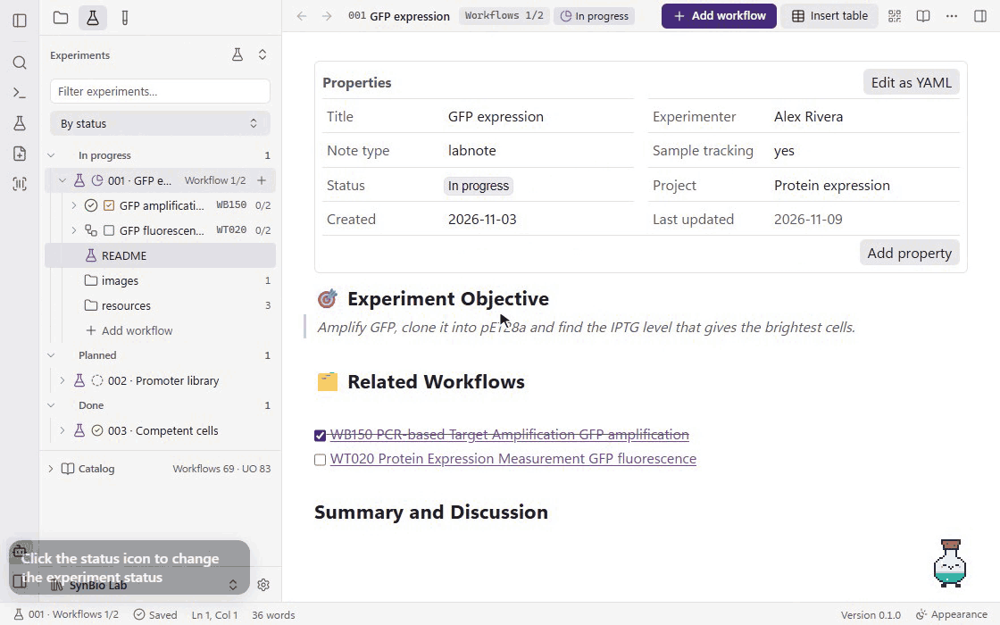
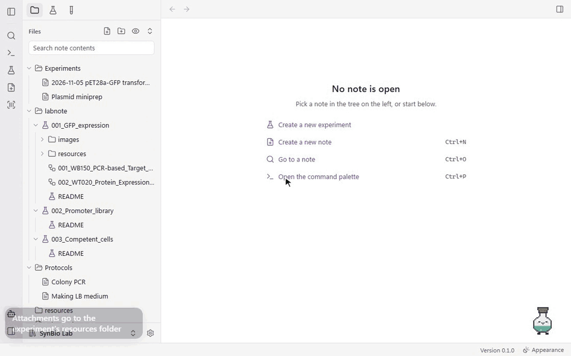
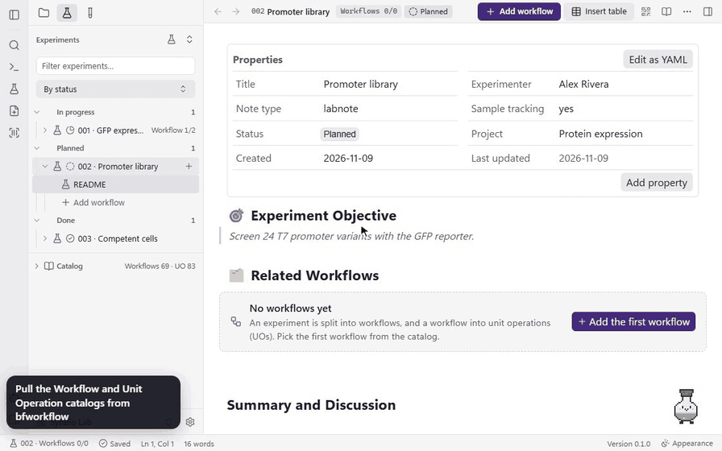
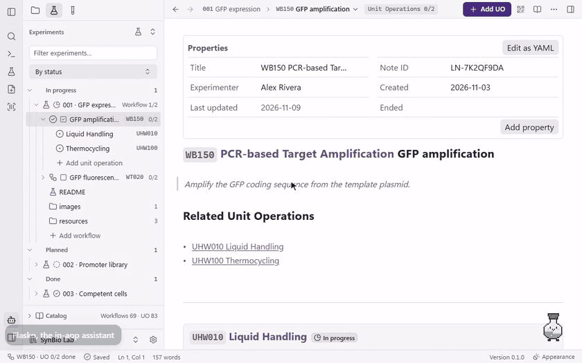
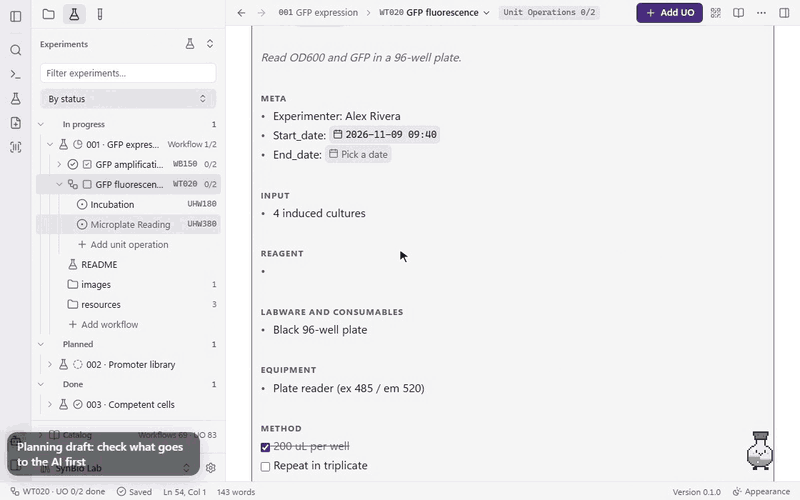
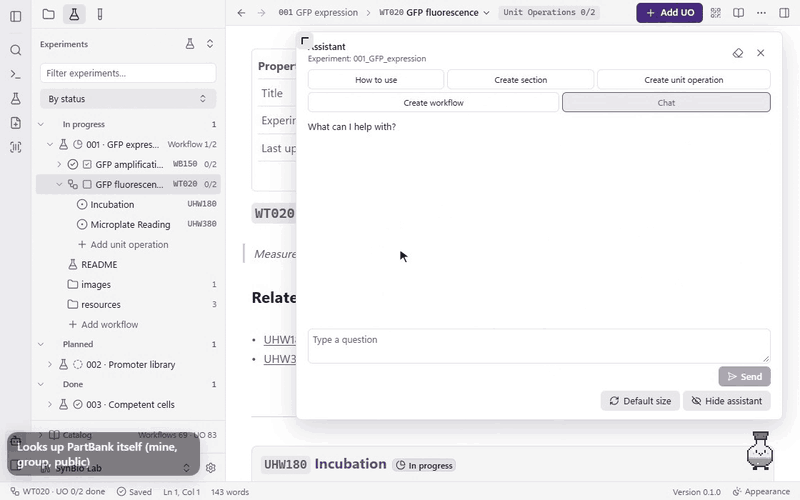
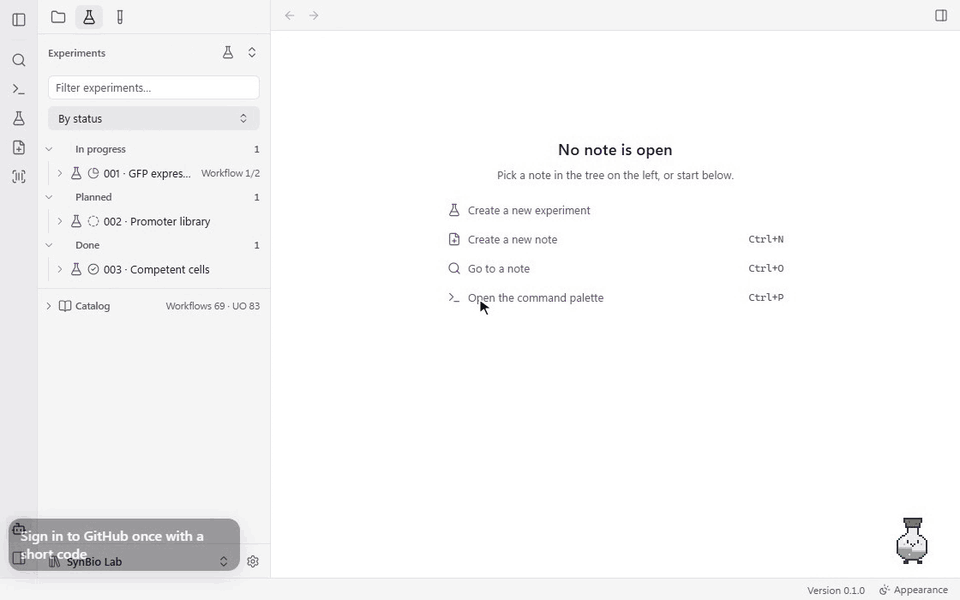
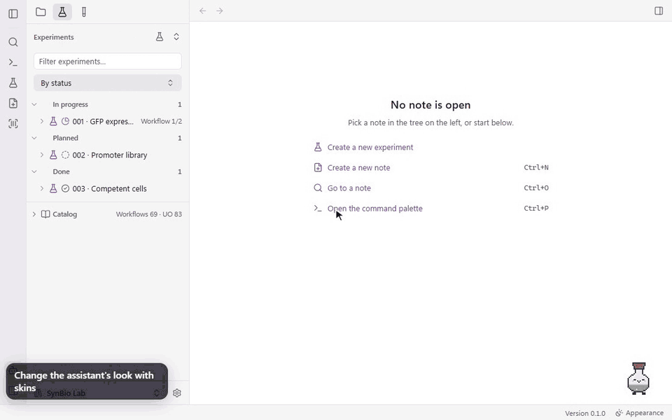
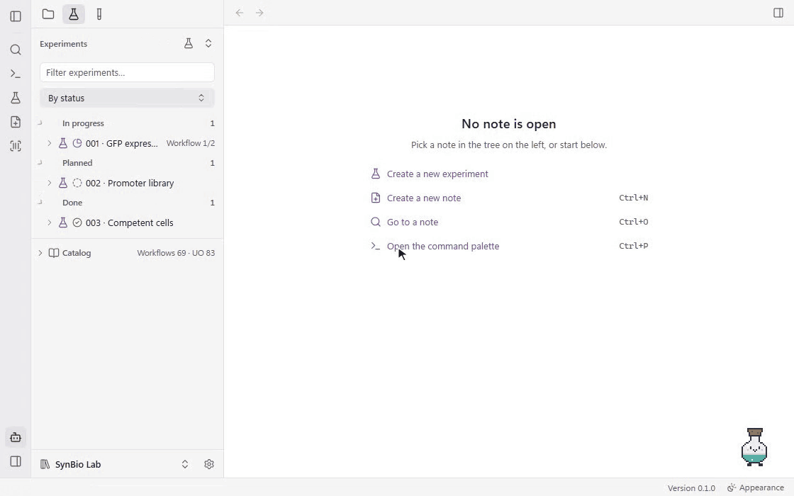

# labnoteO Desktop

**A Windows app for biology lab notebooks**

labnoteO Desktop is a Windows app for [labnoteO](https://github.com/sblabkribb/labnoteo), the Markdown
lab notebook for biology and bioinformatics experiments. Your notes are plain `.labnote.md` Markdown
files in a folder on your PC, so any Markdown editor can open them too.

**English** · [한국어](README.ko.md)

[Features](#features) · [Install](#install) · [Build from source](#build-from-source) · [Changelog](CHANGELOG.md) · [Apache-2.0 License](LICENSE)

## Features

The features are listed in the order a new user meets them. The GIFs were recorded from the app's
own interface, running against a demo vault with made-up data and no real servers.

**Getting started**
[Start](#1-start-with-one-installer) ·
[Editor](#2-editor-and-tables) ·
[Links](#3-links-backlinks-and-outline) ·
[Search](#4-search-the-whole-vault)<br>
**Running an experiment**
[New experiment](#5-new-experiment-and-its-first-workflow) ·
[Workflows](#6-workflows-and-unit-operations) ·
[Reorder](#7-reorder-insert-and-delete-workflows-move-unit-operations) ·
[Status](#8-experiment-status-and-the-workflow-done-checkbox) ·
[Samples](#9-samples) ·
[Attachments](#10-attachments-image-and-csv-viewers-csv-export) ·
[PartBank](#11-partbank) ·
[bfworkflow](#12-bfworkflow) ·
[Worksheets](#13-note-ids-qr-codes-and-worksheets) ·
[Scans](#14-scan-import)<br>
**AI**
[Provider](#15-ai-provider-and-result-summaries) ·
[Assistant](#16-the-assistant) ·
[Drafts](#17-ai-drafts-planning-and-method) ·
[Lookups](#18-lookups-web-literature-partbank-and-the-workflow-server)<br>
**Sharing and connecting**
[GitHub](#19-upload-to-github) ·
[MCP](#20-mcp-server-and-external-mcp-servers) ·
[Other AI tools](#21-using-another-ai-tool)<br>
**Make it yours**
[Skins](#22-assistant-skins-and-the-gallery) ·
[Theme and language](#23-light-dark-english-korean) ·
[Updates](#24-automatic-updates)

### Getting started

#### 1. Start with one installer

On first launch, create a new vault or open an existing notes folder. The app remembers it and opens
straight into it next time. An existing folder opens as is, and settings folders that other apps
keep in it are never touched. Notes are saved as `.labnote.md` files in that folder.


#### 2. Editor and tables

Formatting shows as you type, and a note's front matter appears as a Properties grid with a status
chip. Edits save automatically, and if a note changes on disk while you are editing, the app asks
before overwriting it. Right-click for **Insert** and **Format** menus. Ctrl+E switches to the plain
Markdown source and back, Ctrl+O opens the quick switcher, and the command palette groups every
command by purpose and shows its shortcut.


Insert a table from the right-click **Insert** menu or with Ctrl+Alt+T; Tab moves between cells
and adds a row at the last cell.

#### 3. Links, backlinks and outline

Type `[[` to link another note with autocomplete. Click a link to open it, see which notes link
back, and jump between headings with the outline. Outline and links live in the right sidebar,
which you open from the ribbon.


#### 4. Search the whole vault

Full-text search across every note, backed by a local SQLite index. It also matches inside words,
which matters for Korean, where a term is usually followed by a particle.


### Running an experiment

#### 5. New experiment and its first Workflow

An experiment is a folder; inside it each Workflow is a numbered note, and each Workflow holds
Unit Operations. **New experiment** asks only for a title and the experimenter (already filled
in). The experiment's README then offers to add the first Workflow from the catalog. The catalog
ships with the app; **Update catalogs** in the command palette refreshes it, and **Sync catalogs from
bfworkflow** pulls your lab's own.


#### 6. Workflows and Unit Operations

The Experiments panel lists experiments with their Workflows and Unit Operations, grouped by status,
experimenter, project, last update or open discussion. **Add UO** inserts a Unit Operation from the
catalog as a card with Start and End date chips. Checklist progress and Workflow counts show up in
the panel as you work, and the note's `last_updated` is stamped for you.


#### 7. Reorder, insert and delete Workflows; move Unit Operations

Move a Workflow with its menu, Alt+Shift+Up/Down or by dragging. **Add Workflow after this** inserts
one in between, and **Delete Workflow…** moves it to the Recycle Bin. The file numbers, links and
the README checklist follow every change. Unit Operations move the same way inside their note.



#### 8. Experiment status and the Workflow done checkbox

Click an experiment's status icon to pick its status (such as Planned, In progress, Needs review,
Done, Failed, Discontinued or Needs repeat) or clear it; the experiment moves to that group. Each
Workflow has a done checkbox, in the Experiments tree and in the README's Related Workflows list, and
the experiment shows "Workflow n/m". When every Workflow is done, the app gently offers to mark the
experiment done.



#### 9. Samples

Type `@` to reference a sample. The Samples panel shows each sample's description and storage
location, and one command writes the experiment's sample table into the note.


#### 10. Attachments, image and CSV viewers, CSV export

Files you drop into a note are saved in the experiment's `resources` folder. Images and CSV files
open right in the app (zoom and fit for images, a table for CSV), and other files get a card with
**Open with default app** and **Show in folder**. **Export this note's tables to CSV** (or all tables
of the experiment) writes CSV files next to the note.



#### 11. PartBank

Search PartBank for a part and register it as a sample in one step; its storage location comes
along, and usage can be reported back.


#### 12. bfworkflow

Connect the Workflow server, [bfworkflow](https://github.com/sblabkribb/bfworkflow), to sync your
lab's catalog (**Sync catalogs from bfworkflow** in the command palette) and create notes straight
from a design on the server (**Create notes from a bfworkflow design**).



#### 13. Note IDs, QR codes and worksheets

Every note gets an ID with a QR code and barcode. Print an A4 worksheet per Unit Operation, or the
whole note, and fill it in by hand at the bench.


#### 14. Scan import

Photograph or scan a filled-in worksheet and import it: the QR code finds the right note, and the
image is filed under the matching Unit Operation. Scans can also come in from a watched folder or a
Slack channel.


### AI

#### 15. AI provider and result summaries

Connect any OpenAI-compatible endpoint, including a local model. **Test connection** checks the
model and reads its context window. Thinking mode, max output tokens and temperature are under
**Advanced**. API keys are kept in Windows Credential Manager, never in the vault. AI commands such
as **Summarize Workflow results** put the answer into the note as a callout with the model and date.


#### 16. The assistant

Flasko, the flask in the bottom-right corner, is the in-app assistant. Click it for quick chips
(how-to, add a section, a Unit Operation or a Workflow) or a free chat. Questions about Workflows and
Unit Operations are answered from the catalog first, and every answer carries source chips you can
click. **Insert into note** adds the answer with its sources. Anything that would change a note is
shown as a preview and runs only after you allow it. The chat window can be resized, and chat
history is kept per experiment in this PC's app folder, never in the vault.



#### 17. AI drafts: planning and Method

**AI: Draft Unit Operation planning** first shows the context it will send (README, earlier steps,
catalog description, protocol) with a token estimate, so you can untick what should stay private. It
then streams its thinking and writing live and fills the Reagent, Labware, Equipment and Method
sections. **AI: Draft Method section** and **AI: Prefill Input from previous step** work the same
way. AI-written lines stay highlighted until you press **Done** on them (Esc clears them all); the
highlight is never saved into the file. A setting brings back the old "review it, then delete this line" marker if you want
it in the file.



#### 18. Lookups: web, literature, PartBank and the Workflow server

The assistant can look things up for you and show where each answer came from: PartBank parts and
their storage locations (labelled mine, group or public), papers from PubMed, Europe PMC, Crossref
and bioRxiv, web pages through your SearXNG search server, and designs and methods on the Workflow
server. All of these tools are read-only, and a web search asks before it runs.



### Sharing and connecting

#### 19. Upload to GitHub

Sign in to GitHub once with a short code, and each experiment folder becomes its own private
repository under your account or your lab's organization. Before anything is sent you check the
file list; secret files such as `.env` and keys are always left out, and the files are scanned for
saved keys. Later uploads send only the changes. You can revoke the app's access on github.com at
any time.



#### 20. MCP server and external MCP servers

Turn on the built-in MCP server to let an AI client read and work with your notes. It listens on
127.0.0.1 only, and the app copies a ready-made client setup with your access token. In the other
direction, add external MCP servers (RAPID and BioModel Portal presets, or your own) and choose
per server whether the assistant may use their tools.


#### 21. Using another AI tool

Flasko runs on the app's own AI (the provider you set in Settings → Integrations). Other AI tools,
such as Claude Code or DeepSeek Harness (`dsh`), are not built into the app and the app ships no
Node.js or other runtime for them. They connect from outside, on the same vault:

1. In Settings → Integrations, turn on the MCP server and copy the client setup into your tool.
2. Install the labnoteO skill (SKILL.md) with "Install for Claude Code", or save it with "Save as…"
   and point your tool at it. It explains the vault layout and the MCP tools.
3. Ask your tool to work on an experiment. Every change it makes goes through the MCP server's own
   approvals, and its keys stay in that tool, not in labnoteO.

The assistant does not relay these tools; they talk to the MCP server directly.

### Make it yours

#### 22. Assistant skins and the gallery

Change the assistant's look with skins. Browse the skin gallery, preview each skin's animations,
check its author and licence, and install it. You can also import and export `.labnoteo-skin` files,
or make your own skin from PNG sprite sheets with a live preview.



#### 23. Light, dark, English, Korean

Choose a light or dark theme, or match Windows, from the appearance button in the status bar.
Switch between English and Korean at any time; the switch is instant and keeps unsaved edits.


#### 24. Automatic updates

The installed app checks for a new version when it starts, every 6 hours, and when you come back
after more than an hour away. A new version downloads quietly in the background, and the button at
the bottom left shows the progress. It is installed only when you click **Update** (open notes are
saved first). **Check for updates** in the command palette checks right away.



## Install

[Code signing policy](docs/CODE_SIGNING_POLICY.md) · [Privacy policy](docs/PRIVACY.md)

SignPath Foundation onboarding is being prepared. Production code signing is not yet enabled.

Windows 10 or 11 (64-bit).

Installers are published on the [Releases](https://github.com/sblabkribb/labnoteo-desktop/releases)
page. To build it yourself, see [build from source](#build-from-source).

- The installer is not code-signed, so Windows SmartScreen shows a warning on first install.
  Choose **More info → Run anyway**.
- Once installed, the app [updates itself](#24-automatic-updates) from new releases.

### What you set up yourself

The app works without any account. These connections are optional, and you enter them in
**Settings → Integrations** (or load them all at once from a connection file with **Import from a
file**):

- **AI provider**: the address, model and API key of an OpenAI-compatible endpoint (a local model
  needs no key). Needed for AI commands, drafts and the assistant.
- **PartBank** and **bfworkflow** (the Workflow server): their addresses and API keys.
- **Web search**: the address of a SearXNG server, if you want the assistant to search the web.
- **Scan import from Slack**: a Slack bot token and channel.
- **GitHub**: sign in from the first upload; no token to copy.

API keys and tokens are stored in Windows Credential Manager, never in the vault.

## Build from source

Prerequisites: [Node.js](https://nodejs.org/) 22, the [Rust](https://rustup.rs/) stable toolchain,
the Microsoft C++ Build Tools, and WebView2 (already part of Windows 11). See the
[Tauri prerequisites](https://tauri.app/start/prerequisites/).

```powershell
git clone --recursive https://github.com/sblabkribb/labnoteo-desktop.git
cd labnoteo-desktop/app
npm ci
npm test
npm run tauri:build
```

The installer is written to
`app/src-tauri/target/x86_64-pc-windows-msvc/release/bundle/nsis/`.
For development, run `npm run tauri dev`.

The labnoteO core (`@labnoteo/core`) is included as a git submodule at `app/vendor/labnoteo`, so
the app and the labnoteO plugin share the same note logic. A scheduled workflow
(`sync-core`) checks for a new labnoteO release every 6 hours. When the app's tests and build pass on
it, the update goes into `main` automatically; when they fail, an issue reports which release broke
the app.

## License

[Apache License 2.0](LICENSE).
